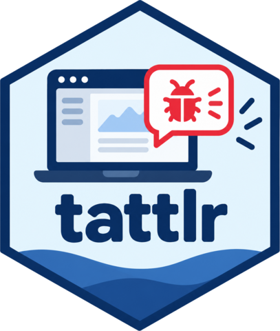
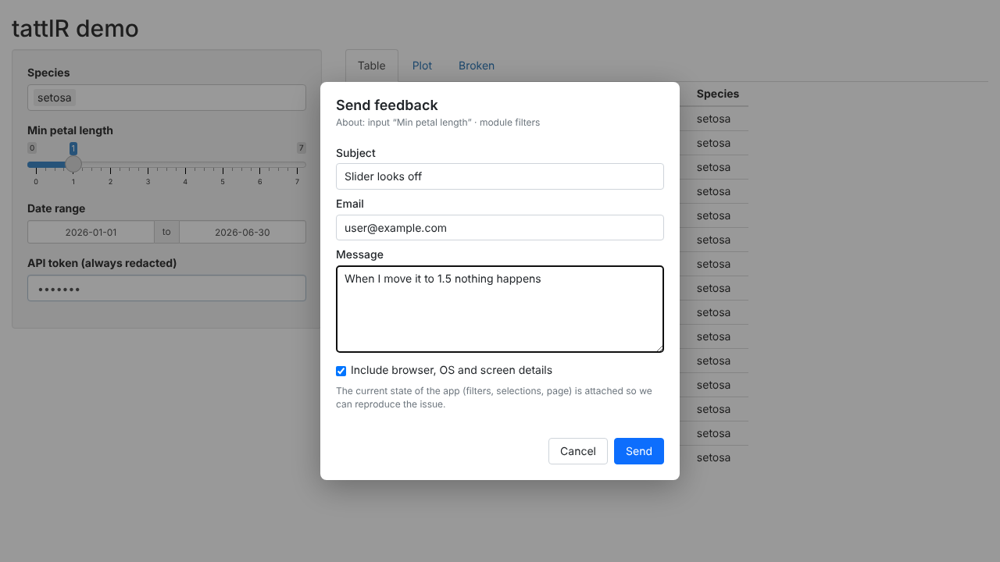

# tattlr 

<!-- badges: start -->
[](https://github.com/karnaugh94/tattlr/actions/workflows/R-CMD-check.yaml)
[](https://lifecycle.r-lib.org/articles/stages.html#experimental)
[](https://github.com/karnaugh94/tattlr/blob/main/LICENSE)
<!-- badges: end -->

Right-click → **Send feedback / report bug**, anywhere in a shiny app. When you switch it on with an env var or option, users get a small modal (subject, optional email, message, and a checkbox for browser/OS/screen details). The package then writes a Markdown debugging report that includes a ready-to-run reprex of every input value.



When it's disabled (the default), `tattlr_server()` and `use_tattlr()` do nothing and nothing is sent to the browser.

## Install

```r
remotes::install_github("karnaugh94/tattlr")
# or from a local copy
install.packages("path/to/tattlr", repos = NULL, type = "source")
# or: remotes::install_local("path/to/tattlr")
```

## Use

The only call you need is in the top-level server:

```r
server <- function(input, output, session) {
  tattlr::tattlr_server()
  ...
}
```

It injects the browser side once the session starts. You can also add `use_tattlr()` to the UI, which loads it with the page so JS errors during page load are captured too. Loading it twice is harmless.

```r
ui <- fluidPage(use_tattlr(), ...)
ui <- bslib::page_navbar(header = use_tattlr(), ...)   # navbar pages: use header=, not a bare argument
```

In golem, put `tattlr::use_tattlr()` in `golem_add_external_resources()` and `tattlr::tattlr_server()` in `app_server()`.

```sh
TATTLR_ENABLED=true TATTLR_DIR=./feedback R -e 'shiny::runApp()'
```

Shift + right-click still opens the browser's own menu. You can also open the modal yourself from JS with `tattlr.open(element)`.

Demo: `shiny::runApp(system.file("examples/demo", package = "tattlr"))` (set the env vars first).

## Configuration

Every setting can be an option (`options(tattlr.dir = ...)`) or an env var (`TATTLR_DIR`). If both are set, the option wins. Arguments passed to `tattlr_server()` / `use_tattlr()` override both.

| Setting | Env var | What it does |
|---|---|---|
| enabled | `TATTLR_ENABLED` | `true`/`1`/`yes` switches the tool on |
| dir | `TATTLR_DIR` | Folder for `feedback-<id>.md` + `.rds` |
| email_to | `TATTLR_EMAIL_TO` | Comma-separated recipients |
| email_from | `TATTLR_EMAIL_FROM` | Sender (defaults to the first recipient) |
| smtp_host / smtp_port / smtp_user / smtp_password | `TATTLR_SMTP_*` | SMTP server for the built-in sender (needs `emayili`) |
| redact | `TATTLR_REDACT` | Regex on input ids whose values get `<redacted>` |
| button | `TATTLR_BUTTON` | Also show a floating "Feedback" button (touch devices) |
| button_position | `TATTLR_BUTTON_POSITION` | `bottom-right` (default), `bottom-left`, `top-right`, `top-left` |
| app_name | `TATTLR_APP_NAME` | Shown in the report and email subject |
| auto_errors | `TATTLR_AUTO_ERRORS` | `true` reports errors automatically (see below) |
| auto_errors_limit | `TATTLR_AUTO_ERRORS_LIMIT` | Max automatic reports per session (default 5) |
| auto_errors_window | `TATTLR_AUTO_ERRORS_WINDOW` | Seconds before the same error is reported again (default 3600) |
| auto_errors_prompt | `TATTLR_AUTO_ERRORS_PROMPT` | `true` shows a small "add details" notice after an automatic report |
| input_log | `TATTLR_INPUT_LOG` | How many recent input changes to record (default 30, `0` turns it off) |
| screenshot | `TATTLR_SCREENSHOT` | `true` offers users to attach a masked screenshot (see below) |

Destinations can be combined. If none is set, the report is printed to the R console. The email's Reply-To is set to the user's address when they give one, and the `.rds` is attached.

### Custom destinations

```r
tattlr_server(
  on_report = function(report, md) {
    # e.g. gh::gh("POST /repos/me/app/issues", title = report$subject, body = paste(md, collapse = "\n"))
  },
  send_email = function(to, from, subject, body, reply_to, attachments) {
    # use blastula / Microsoft Graph / whatever instead of SMTP
  },
  extra = function(session) list(user = session$user, app_version = "1.4.2")
)
```

## Destinations: GitHub, Teams, Azure DevOps, Slack

Set the env vars for a destination and every report goes there too. You can combine them with the folder and email.

| Destination | Env vars | What it creates |
|---|---|---|
| GitHub | `TATTLR_GITHUB_REPO` (`owner/repo`), `TATTLR_GITHUB_TOKEN` (or `GITHUB_PAT`) | An issue with the full report, labelled `tattlr` (+ `auto-error`) |
| Microsoft Teams | `TATTLR_TEAMS_WEBHOOK` | A summary card in a channel |
| Azure DevOps | `TATTLR_AZDO_ORGANIZATION`, `TATTLR_AZDO_PROJECT`, `TATTLR_AZDO_TOKEN` (+ optional `TATTLR_AZDO_TYPE`, `TATTLR_AZDO_AREA_PATH`) | A Bug (or other work item type) with the report as its repro steps, tagged `tattlr` |
| Slack | `TATTLR_SLACK_WEBHOOK` | A summary message |

A few notes on setup:
- **Teams:** use a Workflows webhook, made with the "Post to a channel when a webhook request is received" template. The old Office 365 connector webhooks are retired.
- **Tokens:**
  - GitHub: the token needs "Issues: write".
  - Azure DevOps: the PAT needs "Work Items: Read & write".
- **Delivery and failures:** Teams and Slack get a summary, while the full report stays in the tracker, folder or email. A failing destination logs a warning without the webhook URL (that's where its secret lives) and doesn't stop the others.

In code, the same destinations are functions you can configure explicitly, and you can add your own:

```r
tattlr_server(destinations = list(
  github = tattlr_github("me/app", labels = c("tattlr", "from-users")),
  teams  = tattlr_teams(Sys.getenv("TEAMS_URL"))
), on_report = function(report, md) { ... })
```

`tattlr_github(api_url = )` and `tattlr_azure_devops(base_url = )` point at GitHub Enterprise Server and Azure DevOps Server.

## Automatic error reports

With `TATTLR_AUTO_ERRORS=true`, errors are reported without the user doing anything:

- **Outputs that fail to render.** `validate()`/`need()` messages and `req()` are expected and are ignored.
- **Unhandled errors that close the session** (shiny >= 1.8.1).

With shiny >= 1.8.1 both kinds include the R traceback, with file and line. Older shiny reports output errors only, without a traceback.

They are written as `error-<id>.md` / `.rds`, next to the user reports. They never include user-typed text or browser details. Two limits keep them quiet:
- At most `auto_errors_limit` reports per session.
- The same error (same output and message) is reported at most once per `auto_errors_window` seconds per R process. The next report says how many repeats were skipped. `tattlr_reset_auto_errors()` clears that memory.

`TATTLR_AUTO_ERRORS_PROMPT=true` adds a small notice after an automatic report, with an "Add details" button that opens the feedback dialog prefilled.

## Screenshots

Off by default. With `tattlr_server(screenshot = TRUE)` (or `TATTLR_SCREENSHOT=true`) the dialog offers "Attach a screenshot of the page". Nothing is captured until the user ticks it, and they see the exact image before sending.

Typed text never appears in the image: every text field, text area and rich-text editor is blanked, whether or not its content has reached shiny yet, so a half-written confidential draft can't leak. To hide anything else (a table of salaries, a customer card), give it the class `tattlr-mask` or a `data-tattlr-mask` attribute:

```r
card(class = "tattlr-mask", tableOutput("salaries"))
```

The image is saved as `<report>.jpg` next to the report and attached to the email. GitHub, Teams, Azure DevOps and Slack get a note pointing to it; custom destinations find the JPEG bytes in `report$screenshot`. Automatic error reports never include a screenshot.

## What a report contains

- Subject, message, optional email, server and client timestamps, URL.
- **Where:** the page (the chain of `tabPanel`s around the clicked element), the module namespace (taken from the nearest input/output id), the nearest input with its label and current value, the nearest output, a CSS selector, text and HTML of the clicked element, and the active tab of every tabset.
- Every output currently showing an error, with its message.
- The last 20 JS console errors and uncaught exceptions.
- **Steps before the report:** the last 30 input changes with how long before the report each happened, plus a `testServer()` snippet that replays them in order. Typing and slider drags are collapsed to their final value. Password values are never recorded.
- **Reproduce:**
  - The URL at the time of the report, including the query string and hash, so apps that drive inputs or navigation from GET parameters reproduce by opening it.
  - If the app uses `enableBookmarking("url")`, a bookmark link that restores the inputs. Passwords, redacted inputs, action buttons and file uploads are left out of it.
  - `input <- list(...)` with every input value, plus a `shiny::testServer(server, { session$setInputs(...) })` snippet. The `.rds` keeps the exact R objects (`readRDS(path)$inputs`) for things `dput` can't round-trip.
- Browser environment (only if the user ticked the box): user agent, platform, language, screen, viewport, DPR, timezone, colour scheme.
- Server: R and shiny versions, working dir, session token, pid, plus whatever `extra()` returns.

Password inputs are always redacted.

## Tested with

These were tested in headless Chromium:
- **bslib** (dev version): the `flights` showcase, including dark mode, plotly, DT and histoslider.
- **bs4Dash**: the showcase app, with AdminLTE dark mode and an open Bootstrap 4 modal.
- **shinyMobile**: the gallery app, with Framework7 dark theme and the floating button on an iPhone viewport.
- **golem**: a fresh `create_golem()` app with a module.
- `showModal()` dialogs on Bootstrap 3 and 5.

The tattlr dialog follows the app's light or dark look rather than the OS setting. When a Bootstrap modal is open, it mounts inside that modal so the modal's focus trap doesn't block typing.

## Limitations

- Input values come from the server snapshot, so inputs without a binding (pure JS widgets that never call `setInputValue`) don't show up.
- The module namespace is inferred from ids (`ns-id`), so a custom `NS()` separator isn't recognised.
- Screenshots are re-drawn from the page (via html-to-image), not taken by the OS, so cross-origin images, iframes and some web fonts may be missing or look slightly off.
- Reports go through the same R process as the app, so a busy session (a long render) delays the "sent" confirmation until it's free.
- Element text is captured as-is, so right-clicking an output that echoes a secret puts that text in the report. Only input values are redacted.
